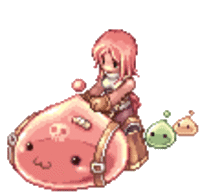

<h1 align="center">Hi, I'm Shinnapat Koparamestrisin 👋</h1>

  

---

### 🧑‍💻 About me

- 💼 **Backend Software Engineer** at **Lodash (Thailand) Co., Ltd.**
- ⚙️ Building APIs, event-driven services and the data plumbing behind them
- 🎨 Comfortable on the front-end too with Next.js & React
- 💪 Off the keyboard, you'll find me at the gym

 

### 🔧 Tech Stack

**Languages** 

**Backend & Frameworks** 

**Data & Messaging** 

**Cloud & DevOps** 

 

  <picture>
    <source media="(prefers-color-scheme: dark)" srcset="https://streak-stats.demolab.com?user=PPHamster&hide_border=true&theme=github-dark-blue" />
    
  </picture>

<picture>
  <source media="(prefers-color-scheme: dark)" srcset="https://raw.githubusercontent.com/PPHamster/PPHamster/output/github-snake-dark.svg" />
  
</picture>

 

  <i>“Love is nothing more than a bug in the brain's electrical circuitry.”</i>
   
  — Ryuunosuke Akasaka, <b>The Pet Girl of Sakurasou</b>

